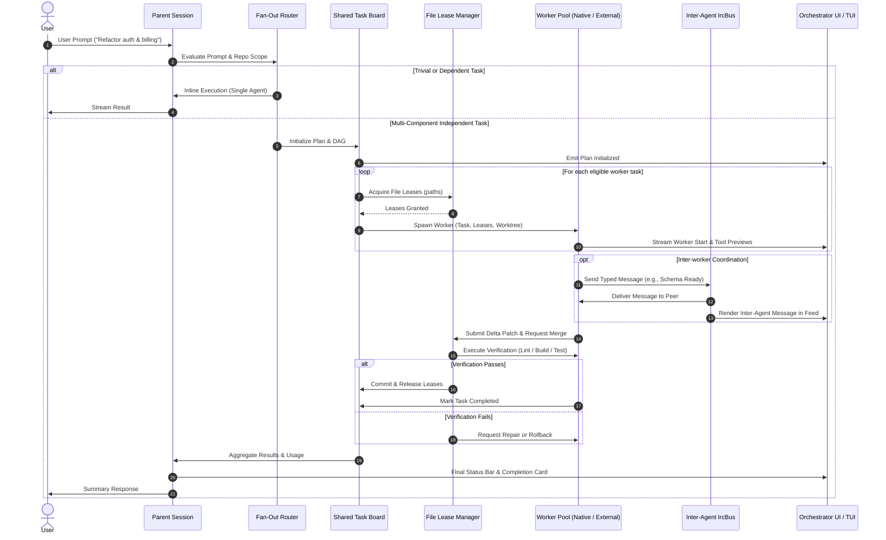

# Mars Multi-Agent Orchestrator: System Architecture & Technical Design

**Status**: Draft Design Document  
**Target Milestone**: v0.2.0  
**Authors**: Mars AI Engineering Assistant  
**Repository**: `MarsAI-org/mars-agent`  
**License**: MIT  

---

## Executive Summary

This document presents the technical design and architectural specifications for the Mars Multi-Agent Orchestrator. Mars is built for high speed and developer flow; the orchestrator preserves that positioning by defaulting to single-agent execution for small and medium tasks, engaging parallel fan-out only when subtasks exhibit high file independence and clear automated verification boundaries. File collisions are eliminated prior to token expenditure through pre-emptive path-based write leases, while child sessions operate under a strict hierarchical permission intersection invariant (`child_permissions = parent_permissions ∩ requested_permissions`).

For Android and Termux environments, this specification prioritizes native, non-proot execution. An audit of this repository confirms that no Android-specific build target exists today (VERIFIED, `scripts/ci-release-build-binaries.ts:31-88`); all statements regarding on-device execution behavior, dynamic linker compatibility, and mobile runtime characteristics are UNVERIFIED pending physical device testing in Milestone 2. Termux support is architected around three prioritized native tiers: (1) a glibc loader compatibility launcher running the existing `linux-arm64` binary without containerization, (2) a true native Bionic `aarch64-linux-android` target, and (3) a modular runtime abstraction enabling Node.js on Termux. PRoot is treated solely as an unverified manual workaround of last resort.

---

## 1. Goals and Non-Goals

### 1.1 Goals
1. **Speed First**: Mars is engineered for low latency and high execution speed. Multi-agent coordination must deliver net wall-clock speedups on eligible tasks, never adding orchestration latency when single-agent execution is faster.
2. **Conservative Fan-Out by Default**: A single agent remains the default for all small and medium tasks. Fan-out occurs only when subtasks exhibit high file independence, sufficient task weight, and clear automated verification boundaries.
3. **Transparent Coordination**: The user retains full visibility through a parent orchestration feed, structured agent-to-agent message stream, per-worker live panels (streaming tool calls and diffs), and an aggregated status bar.
4. **Native Android / Termux Support (No PRoot Required)**: The core Mars engine and a reduced orchestrator profile must be usable on Android via Termux natively without PRoot, honoring mobile resource constraints (thermals, battery, terminal width, and background process limits).
5. **Strict Hierarchical Safety**: Subagents inherit permissions via strict intersection (`child_permissions = parent_permissions ∩ requested_permissions`). A child worker can never possess broader permissions or looser approval gates than its parent.
6. **Pluggable Worker Backends**: Support native in-process Mars subagents, worker-thread agents, and external agent CLIs (e.g. Codex, Cursor) via a unified event-streaming adapter contract.

### 1.2 Non-Goals
1. **Unconstrained Fan-Out (Parody Orchestration)**: Spawning multiple subagents for trivial edits (e.g., changing a CSS class or button color) is an explicit anti-goal.
2. **Debate / Consensus Overhead**: Multi-turn debates and consensus loops that consume tokens without generating verifiable code modifications are excluded.
3. **Secret Storage for External Agents**: Mars does not manage or store credentials or API keys for external agent CLIs; users supply credentials via their own runtime environment.
4. **Desktop Heavyweight Services on Mobile**: Running multiple local Language Server Protocol (LSP) daemons, container runtimes, or local LLM inference engines on low-end Android hardware is out of scope for the mobile orchestrator profile.

---

## 2. Current System Map (Audit & Evidence)

The existing Mars codebase already provides foundational primitives for tasks, isolated worktrees, peer messaging, and terminal rendering. Below is an audit of current capabilities with exact file and line references:

### 2.1 Subagents and Tasks
- **Task Tool Definition & Schema**:  
  - The task tool is registered in `packages/coding-agent/src/task/index.ts:549` (`readonly name = "task"`) and registered with the subprocess registry in `packages/coding-agent/src/task/index.ts:1720`.
  - Wire schemas are generated dynamically via ArkType in `packages/coding-agent/src/task/types.ts:48-101` (`taskItemSchema`, `taskSchema`, `taskSchemaBatch`), supporting single tasks and batch execution (`{ context: string, tasks: taskItem[] }`).
  - Dynamic schema generation is controlled by `getTaskSchema()` in `packages/coding-agent/src/task/types.ts:194-215`.
  - Max recursion depth is capped by `canSpawnAtDepth()` in `packages/coding-agent/src/task/types.ts:222-224` and configured via `cfgTaskMaxRecursionDepth` (default 2) in `packages/coding-agent/src/task/settings.ts:316-334`.
- **Workpool Execution**:  
  - `packages/coding-agent/src/task/workpool.ts:25-56` defines `WorkPoolItem`, `WorkPoolAgent`, and `WorkPoolBatch`.
  - The `WorkPool` class (`packages/coding-agent/src/task/workpool.ts:108-120`) manages keep-alive subagents, round-robin dispatch, turn assignment, and batch result collection.
- **Concurrency & Speculative Launch**:  
  - Concurrency is capped by `cfgTaskMaxConcurrency` in `packages/coding-agent/src/task/settings.ts:280-301` (default 32 concurrent subagents).
  - Subagents can stream and execute speculatively via `cfgTaskSpeculativeLaunch` in `packages/coding-agent/src/task/settings.ts:254-265`.
  - Wall-clock runtime limits are enforced via `cfgTaskMaxRuntimeMs` in `packages/coding-agent/src/task/settings.ts:336-354` (default 0, unbounded).
- **Execution Lifecycle & Termination**:  
  - Subagent execution is managed by `runSubprocess` and `createSubagentRunMonitor` in `packages/coding-agent/src/task/executor.ts:1168-1179, 3950-4019`.
  - Termination reasons are typed in `packages/coding-agent/src/task/executor.ts:1163` (`AbortReason = "signal" | "shutdown" | "terminate" | "timeout" | "budget"`).
- **Worktree Isolation & Merging**:  
  - Git repository validation requires an existing repository (`packages/coding-agent/src/task/worktree.ts:50-64`).
  - Repositories and nested sub-repos are baselined before task execution (`packages/coding-agent/src/task/worktree.ts:202-232, 267-282`).
  - Synthetic trees and delta patches are generated in `packages/coding-agent/src/task/worktree.ts:308-332, 372-388`.
  - Nested repo patches are applied and uncommitted user edits stashed and popped in `packages/coding-agent/src/task/worktree.ts:408-467`.
  - Isolation backends are selected via `ensureIsolation()` in `packages/coding-agent/src/task/worktree.ts:554-570` across APFS, btrfs, ZFS, Linux reflink (`FICLONE`), overlayfs, ProjFS, Windows block clone, and recursive copy (`rcopy`) (`packages/coding-agent/src/task/worktree.ts:474-524`).
  - Worktree directories reside under `~/.mars/wt/<segment>` via `getWorktreeDir()` (`packages/utils/src/dirs.ts:807-809`).

### 2.2 Inter-Agent and Agent-to-UI Communication
- **Inter-Agent Messaging (IRC)**:  
  - An internal IRC messaging system is enabled when subagents can spawn peers (`packages/coding-agent/src/irc/messaging.ts:17-21`).
  - Direct message and broadcast execution occurs via `executeSend()` in `packages/coding-agent/src/irc/messaging.ts:45-102`.
  - Delivery is routed through the singleton `IrcBus` in `packages/coding-agent/src/irc/bus.ts:27-85`, which manages per-agent mailboxes capped at 100 messages (`packages/coding-agent/src/irc/bus.ts:25`), aside injections for busy agents, and revival of parked agents (`packages/coding-agent/src/irc/bus.ts:97-120`).
  - Typed message contracts are defined in `packages/tui/src/tools/irc.ts:7-33` (`IrcMessage`, `IrcDeliveryReceipt`).
- **Internal URL Protocols**:  
  - Agents communicate artifacts and state via virtual URIs:
    - `agent://<id>`: Reads structured output, JSON sidecars, or field paths (`packages/coding-agent/src/internal-urls/types.ts:67, 182, 346`; `packages/coding-agent/src/internal-urls/proc-protocol.ts:167`).
    - `history://<id>`: Reads execution transcripts; referenced as the transcript pointer at `packages/coding-agent/src/irc/bus.ts:110` and in `packages/coding-agent/src/internal-urls/types.ts:252`.
    - `proc://`: Inspects background processes and subagent jobs (`packages/coding-agent/src/internal-urls/proc-protocol.ts:167`).
- **RPC Protocol & Wire Schema**:  
  - Subagent lifecycle and control are exposed over the RPC wire protocol:
    - Commands: `set_subagent_subscription`, `get_subagents`, `get_subagent_messages`, `cancel_subagent`, `steer_subagent` (`packages/coding-agent/src/modes/rpc/wire/rpc-wire.schema.json:255-314`).
    - Events: `subagent_lifecycle`, `subagent_progress`, `subagent_event` (`packages/coding-agent/src/modes/rpc/wire/rpc-wire.schema.json:4524-4570`).
  - Transcript streaming is managed by `RpcSubagentRegistry` and `readRpcSubagentTranscript` in `packages/coding-agent/src/modes/rpc/rpc-subagents.ts:70-120`.

### 2.3 Permissions and Safety Requirements
- **Subagent Provisioning Points (evidence for where the invariant must apply)**:
  - Spawned subagent settings are built in `packages/coding-agent/src/task/executor.ts:1141-1144`, which sets `tools.approvalMode` for the child session.
  - Child tool lists are taken from the agent definition's `tools` field in `packages/coding-agent/src/task/executor.ts:3959-3990`.
- **Requirement for the Orchestrator**:
  - Child permissions must be the intersection of the parent's permissions and the requested permissions:
    `effectiveChildTools = parentActiveTools ∩ requestedChildTools`
  - A child's approval mode must not be looser than its parent's approval mode.
  - This invariant keeps every spawned worker inside the authorization boundary of the session that requested it.

### 2.4 Provider and Model Layer
- **Model Resolution & Catalogs**:  
  - Models are classified via KDL compatibility rules compiled into `packages/catalog/src/compat/rules.json`.
  - Model caching and lookup are handled by `packages/catalog/src/model-cache.ts` using `bun:sqlite`.
- **Cost, Token, and Cache Accounting**:  
  - Session token totals and cost aggregation are handled in `packages/coding-agent/src/session/session-stats.ts:127-147, 150-185`.
  - Child tool usage is aggregated into parent session statistics via `taskToolUsage()` in `packages/coding-agent/src/session/session-stats.ts:140-142, 191-193`.
  - Prompt caching (`cacheRead`, `cacheWrite`) and streaming usage are tracked per assistant message turn in `packages/ai/src/stream.ts` and `packages/ai/src/usage.ts`.

### 2.5 TUI Capabilities & Reusable Components
- **Core TUI Architecture**:  
  - Differential viewport rendering and terminal resize transactions are implemented in `packages/tui/src/tui.ts:60-120, 791-855, 1720-1910`.
  - Layout components include `SplitPane` (`packages/tui/src/components/layout/split-pane.ts`), `Stack` (`packages/tui/src/components/layout/stack.ts`), and `Row` (`packages/tui/src/components/layout/row.ts`).
  - Navigation and display widgets include `TabBar` (`packages/tui/src/components/tab-bar.ts`), `Box` (`packages/tui/src/components/box.ts`), `Table` (`packages/tui/src/components/table.ts`), `ProgressBar` (`packages/tui/src/components/progress-bar.ts`), and `ScrollView` (`packages/tui/src/components/scroll-view.ts`).
  - Full-screen dashboard layouts with header, scrollable body, and docked footer status bars are established in `packages/tui/src/apps/ps-top.ts:348, 640-762`.
- **Task Rendering in TUI**:  
  - `packages/tui/src/tools/task.ts:1350-1420` renders framed tool cards, live spinners (33ms ticks), agent progress rows, and aggregate execution statistics.

### 2.6 Session, Persistence, and Telemetry
- Sessions persist as JSONL streams written to a timestamped `.jsonl` session file under the agent session directory (`packages/coding-agent/src/session/session-manager.ts:1989-1992`); the config root is `~/.mars` (`packages/utils/src/dirs.ts:120`).
- Global agent registry and lifecycle are managed in `packages/coding-agent/src/registry/agent-registry.ts:1-20` and `packages/coding-agent/src/registry/agent-lifecycle.ts`.
- Logs are written by the centralized logger to a rotating `~/.mars/logs/mars.<DATE>.<PID>.log` (`packages/utils/src/logger.ts:4`).

### 2.7 Testing Infrastructure & Mocking
- Deterministic mock sessions and mock model drivers are established in `packages/coding-agent/test/task/executor-yield-loop.test.ts:47` and `packages/coding-agent/test/context-consolidation.test.ts:34`, allowing testing of complex subagent flows, prompt turns, and tool calls without network requests or live API keys.
- Workspace test commands comprise ~202 bucketed test runs across workspace packages (`mars-agent/HANDOFF.md:140`).

### 2.8 External Agents & Subprocess Tool Protocol
- Mars already defines a JSONL-based streaming tool protocol for subprocess agents in `packages/coding-agent/src/task/subprocess-tool-registry.ts:1-70` (`SubprocessToolEvent`, `SubprocessToolHandler`).
- `packages/coding-agent/src/tools/acp-bridge.ts:1-70` provides bridging for external agent client protocols.

### 2.9 Platform and Android/Termux Readiness Audit (each item labeled VERIFIED with file:line evidence or UNVERIFIED)
- **Release Targets & Arch**:  
  - Binary targets in `scripts/ci-release-build-binaries.ts:31-88` define: `darwin-arm64`, `darwin-x64`, `linux-x64`, `linux-arm64`, `linux-musl-x64`, `linux-musl-arm64`, `win32-x64`, `win32-arm64`.
  - Native addons in `.github/workflows/release.yml:56-74` build on `ubuntu-22.04` (x64), `ubuntu-24.04-arm` (arm64), macOS, and Windows.
  - **VERIFIED**: There is an existing `linux-arm64` and `linux-musl-arm64` target. There is **no** Android or Bionic target.
- **Runtime Dependency on Bun**:  
  - Standalone Mars executables are built via Bun compile (`packages/coding-agent/scripts/compile-binary.ts:47`).
  - Mars code relies extensively on Bun-specific runtime APIs: `bun:sqlite` (`packages/catalog/src/model-cache.ts:5`, `packages/ai/src/auth/sqlite-credential-store.ts:7`, `packages/coding-agent/src/memories/storage.ts:1`), `Bun.file()`, `Bun.write()`, `$` (Bun Shell), `Bun.spawn()`, `Bun.serve()`, `Bun.hash()`, `Bun.stringWidth()`, and `Bun.wrapAnsi()`.
  - **VERIFIED**: Node-only fallback is blocked without polyfilling `bun:sqlite`, `Bun.file`, and `$` across hundreds of modules.
- **Native Addon (`pi-natives`)**:  
  - Built with Rust (`crates/pi-natives/Cargo.toml:1-70`) and linked via `napi`.
  - Process management in `crates/pi-shell/src/process.rs:19` uses `#[cfg(target_os = "linux")]` with `open_pidfd` and `/proc/{pid}/task`.
  - **VERIFIED**: In Rust, `target_os = "android"` is distinct from `target_os = "linux"`. Compiling for Android requires updating target gates to `#[cfg(any(target_os = "linux", target_os = "android"))]`.
  - Clipboard (`crates/pi-natives/src/clipboard.rs:1-70`) uses `arboard` (VERIFIED); whether `arboard` supports an Android clipboard backend without X11 or Wayland is UNVERIFIED and must be checked in Milestone 2.
- **Hardcoded Path Assumptions** (code facts VERIFIED from the cited lines; the Termux-specific expectations attached to them are platform knowledge, UNVERIFIED from this repository):  
  - `packages/utils/src/procmgr.ts:127` hardcodes search paths: `["/bin", "/usr/bin", "/usr/local/bin", "/opt/homebrew/bin"]` — Termux's `$PREFIX/bin` is not among them.
  - `packages/coding-agent/src/config/resolve-config-value.ts:132` hardcodes `["/bin/sh", "-c", command]` (UNVERIFIED expectation: on Android/Termux `/bin/sh` is assumed absent without root).
  - `packages/tui/src/status-line/segments.ts:143` hardcodes `/tmp` in scratch roots (UNVERIFIED expectation: Termux temporary storage is assumed located under `$PREFIX/tmp`).
- **Install Script Behavior (`mars-site/install`)**:  
  - `mars-site/install:77-90, 220-239` inspects `uname -s` (returns `Linux`) and `uname -m` (returns `aarch64` -> `arm64`).
  - It selects `linux-arm64` (glibc).
  - **UNVERIFIED**: Standard Termux is understood to use Android's Bionic libc rather than glibc (general platform knowledge; not derived from this repository's code). Executing the glibc `linux-arm64` release directly in native Termux is therefore expected to fail at the dynamic linker, but this must be confirmed on a real device during the Termux feasibility spike.

---

## 3. Proposed Architecture

### 3.1 Component Architecture
The Multi-Agent Orchestrator introduces a coordination layer situated between the parent session and child worker sessions. It builds upon existing primitives:

```
┌────────────────────────────────────────────────────────────────────────┐
│                        Parent Agent Session                            │
│                 (User Intent, Planning & Top-Level Context)            │
└───────────────────────────────────┬────────────────────────────────────┘
                                    │
                         [Fan-Out Router & Decomposer]
                                    │
                                    ▼
┌────────────────────────────────────────────────────────────────────────┐
│                    Orchestrator Coordination Engine                     │
│  ┌────────────────────────┐  ┌────────────────┐  ┌───────────────────┐ │
│  │   Shared Task Board    │  │  File Leases   │  │ Resource & Process│ │
│  │ (Status, DAG, Workers) │  │  (Locks, 2PC)  │  │   Guardrails Cap  │ │
│  └───────────┬────────────┘  └────────┬───────┘  └─────────┬─────────┘ │
└──────────────┼────────────────────────┼────────────────────┼───────────┘
               │                        │                    │
               ▼                        ▼                    ▼
┌────────────────────────────────────────────────────────────────────────┐
│                         Backend Adapter Layer                          │
│  ┌───────────────────────────────┐   ┌───────────────────────────────┐ │
│  │    Native Mars Subagents      │   │     External CLI Adapter      │ │
│  │ (AgentSession, Worktree, PAL) │   │ (Codex, Cursor, JSONL Bridge) │ │
│  └───────────────┬───────────────┘   └───────────────┬───────────────┘ │
└──────────────────┼───────────────────────────────────┼─────────────────┘
                   │                                   │
                   ▼                                   ▼
┌────────────────────────────────────────────────────────────────────────┐
│                        Local Inter-Agent Bus                           │
│     (IrcBus, agent://<id> sidecars, history://<id> transcripts)        │
└───────────────────────────────────┬────────────────────────────────────┘
                                    │
                                    ▼
┌────────────────────────────────────────────────────────────────────────┐
│                    Orchestration UI Synchronizer                       │
│  ┌─────────────────────────────────┐ ┌───────────────────────────────┐ │
│  │ Desktop TUI (Grid + Status Bar) │ │ Mobile TUI (Tabbed Single Pan)│ │
│  └─────────────────────────────────┘ └───────────────────────────────┘ │
└────────────────────────────────────────────────────────────────────────┘
```

### 3.2 Data Flow Diagram



### 3.3 Integration Points in Existing Code
1. **Reuse `WorkPool` (`packages/coding-agent/src/task/workpool.ts`)**: Extend `WorkPool` into the underlying executor for batch turn assignments, keep-alive worker sessions, and result aggregation.
2. **Reuse `IrcBus` (`packages/coding-agent/src/irc/bus.ts`)**: Route typed orchestrator messages through the global `IrcBus`, avoiding duplicate delivery infrastructure.
3. **Reuse Worktree Isolation (`packages/coding-agent/src/task/worktree.ts`)**: Retain `ensureIsolation()`, `captureBaseline()`, `captureDeltaPatch()`, and `applyNestedPatches()` for git-level worker isolation.
4. **Reuse Subprocess Tool Protocol (`packages/coding-agent/src/task/subprocess-tool-registry.ts`)**: Use the existing JSONL stream format as the base contract for external agent CLIs.
5. **New Modules (Justified)**:
   - `packages/coding-agent/src/orchestrator/router.ts`: Implements the fan-out decision engine to prevent frivolous spawning.
   - `packages/coding-agent/src/orchestrator/lease-manager.ts`: Manages path-based read/write leases to prevent file collision before git merge.
   - `packages/coding-agent/src/orchestrator/task-board.ts`: Coordinates plan state, worker status, dependencies, and progress events.
   - `packages/tui/src/apps/orchestrator/`: Implements the multi-worker grid and phone-optimized responsive views.

---

## 4. Core Model

### 4.1 Schema Definitions (TypeScript)

```typescript
export type WorkerBackendKind = "native" | "external-cli";

export type WorkerLifecycleState =
	| "pending"
	| "spawning"
	| "running"
	| "idle"
	| "verifying"
	| "merging"
	| "completed"
	| "failed"
	| "cancelled";

export type OrchestratorMessageKind =
	| "status"
	| "coordination"
	| "handoff"
	| "query"
	| "reply"
	| "alert";

export interface FileLease {
	readonly path: string;
	readonly mode: "read" | "write";
	readonly ownerWorkerId: string;
	readonly acquiredAt: number;
}

export interface OrchestratorMessage {
	readonly id: string;
	readonly from: string;
	readonly to: string; // Worker ID or "all"
	readonly kind: OrchestratorMessageKind;
	readonly body: string;
	readonly timestamp: number;
	readonly status: "sent" | "delivered" | "failed";
}

export interface OrchestratorTask {
	readonly id: string;
	readonly title: string;
	readonly description: string;
	readonly dependencies: readonly string[]; // Task IDs
	readonly targetFiles: readonly string[];  // Declared write set
	readonly assignedWorkerId?: string;
	readonly status: WorkerLifecycleState;
	readonly exitCode?: number;
	readonly error?: string;
	readonly patchSummary?: {
		readonly filesAdded: number;
		readonly filesModified: number;
		readonly filesRemoved: number;
		readonly linesAdded: number;
		readonly linesRemoved: number;
	};
}

export interface WorkerSpec {
	readonly id: string;
	readonly roleLabel: string; // e.g., "svc", "helm", "frontend", "test"
	readonly backend: WorkerBackendKind;
	readonly model?: string;
	readonly isolation: boolean;
	readonly allowedTools: readonly string[];
}

export interface OrchestratorPlan {
	readonly id: string;
	readonly goal: string;
	readonly autoMode: boolean;
	readonly createdAt: number;
	readonly tasks: readonly OrchestratorTask[];
	readonly activeWorkers: readonly WorkerSpec[];
}
```

---

## 5. Decomposition and File Ownership

### 5.1 Decomposition Protocol
1. **Goal Analysis**: The orchestrator evaluates the prompt to identify discrete components with minimal code overlap.
2. **Explicit Deliverables**: Every decomposed subtask must define:
   - A target goal with objective acceptance criteria.
   - A bounded file write set (declared paths).
   - Expected interface contracts (types, exports, schema).
3. **Sequence True Dependencies**: Dependent tasks are sequenced; only strictly independent tasks execute concurrently.

### 5.2 File Lease & Locking Mechanism
To eliminate merge conflicts prior to commit:
- **Write Leases**: A worker must hold a write lease for a file before executing `write`, `edit`, or `ast_edit`.
- **Lock Acquisition**:
  - The orchestrator validates that no two active workers request conflicting write leases.
  - If Worker B requests a file held by Worker A, Worker B is either queued until Worker A releases the lease or signaled to coordinate via `agent://WorkerA`.
- **Read Leases**: Unlimited concurrent read leases are permitted.

### 5.3 Merge & Verification Pipeline
1. **Worker Delta Extraction**: On task yield, the worker's worktree produces a delta patch (`captureDeltaPatch()`).
2. **Pre-Merge Validation**: The worker runs local checks (syntax, diagnostics) inside its isolated workspace.
3. **Two-Phase Integration**:
   - The orchestrator acquires the repository lock (`withRepoLock()`).
   - The patch is applied to the main workspace.
   - Automated verification executes (e.g. `bun run check:tools`, test suite).
   - If verification succeeds, changes are committed.
   - If verification fails, the patch is rejected, diagnostic errors are fed back to the worker for a repair turn, or changes are rolled back cleanly.

---

## 6. Fan-Out Router

### 6.1 Routing Signals & Decision Table
To maintain Mars's speed advantage, the router evaluates four primary signals:

| Signal | Single Agent Threshold | Multi-Agent Eligible |
|---|---|---|
| **Estimated Touch Points** | 1–3 files in a single directory | >= 4 files across distinct modules |
| **Subtask Independence** | High sequential coupling | Zero or low data dependency |
| **Estimated Runtime** | < 15 seconds | > 60 seconds (parallelizable) |
| **Platform Target** | Mobile / Phone (conservative) | High-core desktop / server |

**These thresholds are initial defaults (UNVERIFIED), chosen to keep single-agent the default; they must be validated and tuned by the benchmark plan in Section 12 before being treated as settled values.**

### 6.2 Decision Matrix
- **Trivial / Single-File Edits** (e.g., "make the login button blue", "fix typo in docs"):  
  -> **Single Agent (Zero Fan-Out)**. Cost: 1 call, zero isolation overhead, instantaneous delivery.
- **Independent Cross-Subsystem Features** (e.g., "implement backend route in packages/coding-agent and matching UI component in packages/tui"):  
  -> **Multi-Agent (2 Workers)**. Independent write sets, concurrent execution, coordinated merge.
- **Broad Refactoring Across N Packages**:  
  -> **Multi-Agent (N Workers, bounded by concurrency cap)**.

### 6.3 Configuration & Overrides
- `orchestrator.mode`: `"auto"` (router decides), `"single"` (force 1 worker), `"parallel"` (force fan-out when plausible).
- Platform-aware **initial defaults** (UNVERIFIED; to be tuned by the benchmark plan in Section 12):
  - Desktop / CI: `maxConcurrency = 8`
  - Android / Termux: `maxConcurrency = 2` (conservative initial default to protect thermals, battery, and process limits).

---

## 7. Backend Adapter Interface

### 7.1 Unified Adapter Contract

```typescript
export interface WorkerEventStream {
	onToolCall(cb: (call: { toolName: string; args: unknown }) => void): void;
	onDiff(cb: (diff: { file: string; patch: string; added: number; removed: number }) => void): void;
	onMessage(cb: (msg: OrchestratorMessage) => void): void;
	onExit(cb: (exit: { code: number; error?: string }) => void): void;
}

export interface WorkerBackendAdapter {
	readonly kind: WorkerBackendKind;
	spawn(spec: WorkerSpec, task: OrchestratorTask, cwd: string): Promise<WorkerEventStream>;
	sendMessage(workerId: string, message: OrchestratorMessage): Promise<boolean>;
	cancel(workerId: string, reason: string): Promise<void>;
	getUsage(workerId: string): Promise<{ inputTokens: number; outputTokens: number; cost: number }>;
}
```

### 7.2 Native Mars Workers
- Executed via internal `AgentSession` inside isolated worktrees.
- Direct memory-level event forwarding into the orchestrator.
- Zero network or serialization overhead.

### 7.3 External Agent CLIs (Codex, Cursor, etc.)
- Spawns external CLI binaries via `Bun.spawn` using the established JSONL/stdio protocol (`subprocessToolRegistry`).
- **Security & Credential Model**:
  - Mars stores **zero** third-party tokens or secrets.
  - External CLIs inherit only explicitly allowlisted environment variables (`filterChildShellEnv`).
  - No network credential forwarding across processes.
- **Licensing & Terms-of-Service Risk**:
  - Proprietary agent CLIs may impose Terms of Service restrictions on automated subagent wrappers.
  - **Decision**: Mars ships with native workers enabled by default. External agent adapters are opt-in and require explicit user configuration.
- **External CLIs on Termux**:
  - **UNVERIFIED (vendor/platform knowledge, not repo evidence)**: Proprietary x64/glibc agent CLIs (for example Cursor or proprietary Codex binaries) are assumed not to ship native Android Bionic ARM64 builds and therefore assumed not to run in native Termux. Under a PRoot Linux ARM64 distribution, only binaries published for Linux ARM64 are assumed to run at all. All of this requires device validation in the Termux feasibility spike (Milestone 2).

---

## 8. Guardrails

### 8.1 Safety Invariants
1. **Hierarchical Permission Invariant**:  
   `child_permissions = parent_permissions ∩ requested_permissions`  
   A child worker cannot obtain permissions that the parent session lacks. If the parent operates in read-only mode, no child may acquire write or execution tools.
2. **Approval Tier Requirement**:  
   The child's approval tier must not be looser than the parent's. A parent that requires user confirmation for an action class cannot spawn a child that runs that class unattended.
3. **Budget Caps** (example values are initial defaults, UNVERIFIED; to be tuned by the benchmark plan):  
   - Per-worker token budgets (e.g., max 100k tokens per worker).
   - Global orchestrator token ceiling (e.g., abort entire run if total usage exceeds $2.00 or 500k tokens).
   - Hard wall-clock timeout (`cfgTaskMaxRuntimeMs`, defaulting to 10 minutes on desktop, 5 minutes on mobile).
4. **Global Stop Gesture**:  
   A single abort gesture (`Ctrl+C` or `q`) sends `SIGTERM` / abort signals to all running workers, tears down worktrees, and releases repository locks (500ms is the initial target, UNVERIFIED until measured).
5. **Process Count Cap & Keepalive (Android)**:  
   - **UNVERIFIED platform assumption**: Android 12+ is reported to kill background child processes when a Termux session's process count grows high; the exact threshold is not derived from code and must be treated as unverified. Design to stay well under any plausible limit.
   - Initial default cap (UNVERIFIED; to be tuned by the benchmark): **<= 6 total active processes** on Android (1 parent host + max 2 workers + max 1 shell/compiler per worker).
   - Integration with Termux wake-lock (`termux-wake-lock`) during active orchestration runs is intended to prevent system deep-sleep mid-task (environment behavior UNVERIFIED; `termux-wake-lock` is a Termux add-on assumed installed).

---

## 9. TUI Design

### 9.1 Desktop Layout Sketch (>= 100 columns)

```
┌──────────────────────────────────────────────────────────────────────────────────────────────┐
│  MARS ORCHESTRATOR  │  Task: Implement oauth refresh & billing sync           │ [AUTO] 4m 12s│
│  Progress: [████████████████░░░░░░░░] 2/4 tasks complete                      │ 3 workers    │
├──────────────────────────────────────────────────────────────────────────────────────────────┤
│ PARENT FEED                                                                                  │
│ [14:02:01] router    -> Decomposed into 3 subtasks (auth-core, billing-api, ui-sync)         │
│ [14:02:15] auth-core -> billing-api: JWT refresh contract landed at src/auth/jwt.ts          │
│ [14:02:40] ui-sync   -> waiting for billing-api exports                                      │
├──────────────────────────────────────────────┬───────────────────────────────────────────────┤
│ WORKER 1: auth-core [svc] (running) ⠋        │ WORKER 2: billing-api [svc] (running) ⠋       │
│ Tool: write src/auth/jwt.ts                  │ Tool: bash bun test packages/billing          │
│ + export function refreshTokens(...) {       │ ✓ billing.spec.ts (14 tests passed)           │
│ +   return verify(refreshToken);             │ Files: +42 -8 lines                           │
│ + }                                          │ Diff: packages/billing/src/client.ts          │
├──────────────────────────────────────────────┼───────────────────────────────────────────────┤
│ WORKER 3: ui-sync [view] (idle)              │ WORKER 4: test-suite [qa] (queued)            │
│ Status: Paused waiting for Worker 2 lease    │ Status: Awaiting Worker 1 & 2 completion      │
│ Target: src/components/billing-status.tsx     │ Target: integration tests                     │
├──────────────────────────────────────────────┴───────────────────────────────────────────────┤
│ STATUS: 2/4 done · 2 running · 41 tool calls · +128/-34 lines · $0.042 · [q: Abort] [Tab: Nav]│
└──────────────────────────────────────────────────────────────────────────────────────────────┘
```

### 9.2 Narrow Phone Terminal Sketch (40–55 columns)

```
┌──────────────────────────────────────────────┐
│ MARS [AUTO] 2/4 done · 4m 12s · $0.04        │
├──────────────────────────────────────────────┤
│ [1:auth*]  [2:bill]  [3:ui]  [4:qa]  (Tab)   │
├──────────────────────────────────────────────┤
│ WORKER 1: auth-core [svc] (running ⠋)        │
│ Subtask: Implement JWT refresh contract      │
│ Tool: write src/auth/jwt.ts                  │
│ ──────────────────────────────────────────── │
│ + export function refreshTokens() {          │
│ +   return verify(refreshToken);             │
│ + }                                          │
│ ──────────────────────────────────────────── │
│ Peer Msg: -> billing-api: JWT schema updated │
├──────────────────────────────────────────────┤
│ STATUS: 2 running · +128/-34 lines · [q:exit]│
└──────────────────────────────────────────────┘
```

### 9.3 Narrow Terminal & Mobile Fallback Rules
- When terminal width is `< 80` columns (initial default breakpoint, tunable):
  - Multi-column grid is disabled.
  - The UI falls back to a **Single Focused Worker View** with a top tab bar (`TabBar`) indicating worker status.
  - Users cycle workers via `Tab`, number keys (`1`, `2`, `3`), or swipe/touch if terminal supports mouse events.
- Touch Keyboard Friendly:
  - No reliance on function keys (`F1`–`F12`) or modifier combinations (`Ctrl+Alt+...`).
  - Standard single keys (`q` to abort/close, `Tab` to cycle, `Enter` to expand diff, `Space` to pause/resume).
- Non-TTY / Headless Mode:
  - If `!process.stdout.isTTY` or `--jsonl` is passed, the orchestrator emits single-line JSONL events (`orchestrator_lifecycle`, `worker_event`, `inter_agent_message`, `status_tick`) to stdout.

---

## 10. Observability

1. **Structured Log Files**: All orchestration lifecycle events write to the rotating daily log `~/.mars/logs/mars.<DATE>.<PID>.log` (`packages/utils/src/logger.ts:4`) with `{ correlationId: planId, workerId }`.
2. **Replay & Export Artifact**: At the conclusion of a run, the orchestrator exports `~/.mars/agent/sessions/<id>/orchestration-run.jsonl` recording:
   - Full dependency DAG.
   - Per-worker tool calls, token usage, and durations.
   - Complete inter-agent message logs.
   - Patch application diffs and verification outcomes.
3. **Mobile Low-Overhead Mode**:
   - In low-resource environments, live diff streaming is debounced (initial default 250ms, down from the desktop 33ms spinner cadence; UNVERIFIED value to be tuned by the benchmark) to minimize CPU usage and thermal throttling.

---

## 11. Testing Strategy

1. **In-Process Mock Provider & Fixtures**:
   - Utilize existing `createMockSession` and `createMockModel` (`packages/coding-agent/test/task/executor-yield-loop.test.ts:47`) to simulate multi-turn worker streams deterministically.
2. **Deterministic Scheduling Tests**:
   - Test DAG resolution: independent tasks launch in parallel; dependent tasks block until prerequisites resolve.
3. **File Lease Contention Tests**:
   - Verify that two workers requesting overlapping file writes are serialized and do not produce conflicting diffs.
4. **Hierarchical Permission Downgrade Tests**:
   - Verify that spawning a worker from a read-only parent strips all mutating tools (`write`, `edit`, `bash`) regardless of worker definition.
5. **Cancellation & Global Stop Tests**:
   - Simulate `cancelAll()` and confirm all subprocesses receive termination signals and worktrees are cleaned up (500ms is the initial target, UNVERIFIED until measured).
6. **TUI Layout Snapshot Tests**:
   - Validate ASCII output formatting at 120 columns (Desktop Grid) and 45 columns (Mobile Phone View).
7. **CI Android Coverage (options; recommended default first, none claimed as verified)**:
   - **Recommended**: GitHub-hosted `ubuntu-24.04-arm` runners for Linux ARM64 checks. The runner label is VERIFIED from `.github/workflows/release.yml:60-61`; whether the full TypeScript suite can be scheduled there is UNVERIFIED.
   - **Option**: a PRoot/Termux-based container image for path-resolution smoke tests (UNVERIFIED; image availability and behavior need evaluation).
   - **Option**: self-hosted ARM64 hardware (UNVERIFIED; cost/availability unknown).
   - No Android CI result is claimed by this document.

---

## 12. Benchmark Plan

To validate Mars's core value proposition (speed without waste), the benchmark compares a Single Agent vs Multi-Agent Orchestrator on standardized workloads:

### 12.1 Workload Test Suites
- **Small Task (Trivial)**: Single CSS update / button color change across 1 file.
- **Medium Task (Coupled)**: Renaming an internal interface and updating 3 callers in the same package.
- **Large Independent Task (Modular)**: Adding a new CLI flag in `packages/coding-agent`, updating types in `packages/omptype`, and adding tests in `packages/tui`.
- **Mobile Workload (Reduced)**: Modular documentation and unit test addition on an ARM64 Android environment.

### 12.2 Measured Metrics
- **Wall-Clock Latency**: Total seconds from prompt submission to verified commit.
- **Token Overhead**: Input, output, reasoning, and cache-read tokens consumed.
- **Cost**: Total USD charged.
- **Conflict Frequency**: Number of lease rejections or git patch merge failures.
- **Review Burden**: Diff size and readability for a human engineer.
- **Mobile Hardware Metrics**: Peak RSS memory, CPU thermal throttling, and background process count.

---

## 13. Phased Roadmap

| Milestone | Scope | Key Files Touched | Criteria for Success | Effort |
|---|---|---|---|---|
| **M1: Core Orchestration Engine** | Shared Task Board, Router heuristics, File Lease Manager, Core Scheduler (No UI). | `packages/coding-agent/src/orchestrator/*`, `packages/coding-agent/src/task/*` | Unit & integration tests pass with mock models; file locking prevents collision; permission clamping verified. | Medium |
| **M2: Termux Native Readiness (No PRoot)** | Native Termux environment detection; glibc loader launcher (Tier 1); Rust cfg fixes & PTY pipe fallback (Tier 2); Bun-API runtime inventory (Tier 3); offline self-check command. | `packages/utils/src/dirs.ts`, `packages/utils/src/procmgr.ts`, `scripts/android/mars-termux-launcher.sh`, `crates/pi-shell/*`, `ANDROID_RUNTIME_INVENTORY.md` | Launcher executes binary through glibc loader with clean LD_PRELOAD handling; offline self-check runs; PRoot is not used. | Medium |
| **M3: Two-Phase Merge & Verifier** | Automated build/lint/test verification of worker patches; rollback on failure. | `packages/coding-agent/src/task/worktree.ts`, `packages/coding-agent/src/orchestrator/verifier.ts` | Invalid worker patches are rejected cleanly and rolled back; valid patches merge cleanly. | Small |
| **M4: External CLI Backend Adapter** | JSONL/stdio adapter for external CLIs (Codex, etc.); security sandboxing. | `packages/coding-agent/src/task/subprocess-tool-registry.ts`, `packages/coding-agent/src/orchestrator/adapters/*` | External CLI can be spawned as worker; events stream into orchestrator; tokens reported. | Medium |
| **M5: Desktop Grid & Mobile TUI** | Multi-panel grid view for desktop; responsive tabbed single-panel view for narrow mobile screens; status bar. | `packages/tui/src/apps/orchestrator/*`, `packages/tui/src/tools/task.ts` | 120-col desktop grid renders live diffs; 45-col mobile view cycles workers via Tab/touch. | Large |

---

## 14. Risks and Autonomous Decisions Taken

| Risk | Decision Made | Rationale | Revisit Mechanism |
|---|---|---|---|
| **Frivolous Fan-Out Slows Down Mars** | Fan-out router defaults to Single Agent unless tasks are independent and touch >= 4 files (initial default threshold, to be tuned by the benchmark). | Mars is positioned on speed. Spawning subagents for trivial tasks wastes tokens and adds latency. | Revisit via `orchestrator.minTaskWeight` setting if users want more aggressive fan-out. |
| **Subagent permission inheritance** | Require effective child permissions to be the intersection of the parent's permissions and the requested permissions; approval tier clamps to the parent's tier. | Keeps every spawned worker inside the authorization boundary of the session that requested it. | Revisit only if explicit parent-authorized privilege elevation is designed. |
| **Android background process reaping** | Initial default: hard-cap total process count to <= 6 on Android; concurrency default = 2 (tunable). | Android is reported to kill background child process trees under memory/process pressure; the exact threshold is UNVERIFIED. | Tune via benchmark; allow higher concurrency on rooted devices after measurement. |
| **External Agent CLI Legal / Licensing Terms** | External CLIs disabled by default; adapter interface provided for user opt-in only. | Vendor terms of service may restrict automated wrapper usage; Mars stores no keys. | Users configure their own external CLIs in settings. |
| **Termux Execution Environment** | Native, No-PRoot Strategy in prioritized tiers: Tier 1 (glibc compatibility loader launcher running `linux-arm64`), Tier 2 (native Bionic build with Rust cfg and PTY pipe fallbacks), Tier 3 (runtime abstraction for Node.js). PRoot is excluded as a supported path. | PRoot introduces heavy container overhead and alienates mobile user experience. The glibc compatibility loader inside native Termux enables executing the existing `linux-arm64` binary directly without containerization. PRoot is relegated to an unverified last-resort manual workaround. | Revisit if device testing reveals insurmountable loader or kernel barriers on Android 12+. |

---

## 15. Android / Termux Support: Native No-PRoot Strategy

### 15.1 Strategy Overview and Priority Tiers

PRoot is **NOT** a supported path for Mars on Android/Termux. PRoot containerization incurs severe file system and system-call translation overhead, consumes hundreds of megabytes of unnecessary storage, and prevents seamless integration with the host Termux toolchain. Mars adopts a **Native, No-PRoot Strategy** structured into three prioritized tiers, with Remote Mode as an official fallback:

```
┌──────────────────────────────────────────────────────────────────────────────────┐
│                      Termux Android Support: Priority Tiers                      │
├──────────────────────────────────────────────────────────────────────────────────┤
│ Tier 1: glibc Compatibility Loader (First Deliverable)                           │
│   • Runs the existing linux-arm64 release binary directly in native Termux       │
│   • Uses Termux glibc packages (glibc-repo, glibc, glibc-runner)                 │
│   • Driven by scripts/android/mars-termux-launcher.sh with LD_PRELOAD hygiene    │
├──────────────────────────────────────────────────────────────────────────────────┤
│ Tier 2: True Native Bionic Build (aarch64-linux-android)                         │
│   • Cross-compiles Rust native addons with #[cfg(any(linux, android))]           │
│   • Implements PTY pipe fallback where openpty/forkpty is restricted by Bionic   │
│   • Runtime-agnostic design; documents Android pointer tagging risks             │
├──────────────────────────────────────────────────────────────────────────────────┤
│ Tier 3: Runtime Portability Layer (Node.js Alternative)                          │
│   • Inventories all Bun-specific APIs in packages/*/src (bun:sqlite, etc.)       │
│   • Designs thin runtime abstractions to unlock Termux's official nodejs package │
├──────────────────────────────────────────────────────────────────────────────────┤
│ Fallback: Remote Mode (Phone as Client)                                          │
│   • Termux connects to a remote Mars host over WebSocket RPC                     │
│ Last Resort: PRoot Distro (Manual Workaround Only — UNVERIFIED / Unsupported)    │
└──────────────────────────────────────────────────────────────────────────────────┘
```

#### Tier 1 (First Deliverable): glibc Compatibility Path
- **Mechanism**: Executes the prebuilt `linux-arm64` release binary inside native Termux using Termux's glibc loader packages (`glibc-repo`, `glibc`, `glibc-runner`) without containerization.
- **Launcher Contract**: Invoked via a lightweight POSIX shell script (`scripts/android/mars-termux-launcher.sh`) that:
  1. Detects whether the glibc dynamic linker/loader (`$PREFIX/glibc/lib/ld-linux-aarch64.so.1` or `grun`) is installed.
  2. Clears any inherited Android/Termux `LD_PRELOAD` shims (which inject Bionic hooks that crash glibc ELF binaries).
  3. Executes the binary through the glibc loader, forwarding all arguments, standard streams, exit codes, and process signals.
  4. Fails with a clear, actionable English error message printing the exact commands (`pkg install glibc-repo && pkg install glibc-runner`) when prerequisites are missing.
- **Known Technical Barriers (UNVERIFIED on real hardware)**:
  - *Missing ELF Interpreter*: Standard Termux binaries look for `/lib/ld-linux-aarch64.so.1`, which does not exist in Android root; `grun` or explicit loader invocation resolves this.
  - *Termux LD_PRELOAD Shim*: Termux injects `libtermux-exec.so` via `LD_PRELOAD` to rewrite `/bin/sh` to `$PREFIX/bin/sh`. This Bionic shared object will cause glibc's dynamic loader to abort unless cleared for the child process.
  - *Direct `statx` Syscall on Android 10/11*: Bun makes direct `statx` syscalls. On Android 10/11, SECCOMP filters on certain OEM kernels block `statx` with `EPERM` or `ENOSYS`. Therefore, **Android 12+ is the supported baseline**, and Android 10/11 is designated as **best effort**.

#### Tier 2: True Native Bionic Build (`aarch64-linux-android`)
- **Mechanism**: Builds Mars native addons directly for the Android Bionic C runtime.
- **Required Code Modifications**:
  - Rust crate target gates: Update `#[cfg(target_os = "linux")]` in `crates/pi-shell/src/process.rs:19` to `#[cfg(any(target_os = "linux", target_os = "android"))]`.
  - PTY Handling: Android Bionic libc restricts or alters standard UNIX PTY operations (`openpty`/`forkpty`). Provide a robust fallback to bidirectional standard pipes (`pipe`/`pipe2`) when PTY allocation fails.
  - Runtime Integration: Mars does not vendor or bundle third-party community Bun builds. The codebase is architected to remain compatible with any Bionic-capable JavaScript runtime; runtime availability on Bionic remains an explicit external prerequisite.
- **Known Technical Barriers (UNVERIFIED on real hardware)**:
  - *Pointer Tagging (Top-Byte-Ignore / ARM Memory Tagging Extension)*: Modern Android kernels enable memory tagging and pointer authentication. JIT engines and native memory allocators that store metadata in the upper bits of 64-bit pointers must account for Android heap tagging.

#### Tier 3: Runtime Portability Layer (Node.js Alternative)
- **Mechanism**: Inventories all Bun-specific APIs in the repository and specifies a thin abstraction layer allowing Mars to run under Termux's official `nodejs` package (`pkg install nodejs`).
- **Inventory Summary** (detailed in `ANDROID_RUNTIME_INVENTORY.md`):
  - `bun:sqlite`: 58 call sites across catalog cache, memories, and auth storage.
  - `Bun.file()` / `Bun.write()`: ~498 call sites across tools and file utilities.
  - `Bun.spawn()` / Bun Shell (`$`): ~75 call sites in execution and process management.
  - `Bun.serve()`: 15 call sites in local servers and preview hooks.
  - `Bun.hash()`: 145 call sites in path/content hashing.
  - `Bun.sleep()`: 158 call sites.
- **Cost Estimate**: A comprehensive Node.js adapter requires either a modular runtime abstraction layer or selective polyfills for `bun:sqlite` (via `better-sqlite3` or SQLite WASM) and Bun file/process helpers. This path is evaluated in Milestone 2 as a long-term fallback.

#### Fallback & Last Resort
- **Remote Mode (Phone as Client)**: The phone acts solely as an interactive TUI client connecting to a remote Mars instance running on a desktop, server, or cloud VM via WebSocket RPC (`packages/coding-agent/src/modes/rpc/wire/rpc-wire.schema.json:255-314`). Near-zero battery drain and zero native compilation required on the phone.
- **PRoot Distro (Manual Workaround Only)**: Running a Linux distribution under `proot-distro` is explicitly **unsupported** by Mars tooling. It is documented only as an unverified manual workaround for users whose kernel blocks all native paths.

---

### 15.2 Support Matrix

| Target Tier | Prerequisites | Mars Changes Required | Pros | Cons / Risks | Verdict |
|---|---|---|---|---|---|
| **Tier 1: glibc Compatibility Loader** *(Primary Native Path)* | Termux + `pkg install glibc-repo glibc-runner` (UNVERIFIED on device) | Add `scripts/android/mars-termux-launcher.sh`; normalize search paths and temp directories; handle LD_PRELOAD. | **Runs existing `linux-arm64` binary natively** without containerization or PRoot overhead; full access to host Termux environment. | Requires Termux glibc packages; direct `statx` syscalls may fail on Android 10/11 (Android 12+ baseline). | **Recommended First Deliverable** (UNVERIFIED on real hardware; targeted for M2) |
| **Tier 2: True Native Bionic Build** *(Long-Term Native)* | aarch64-linux-android Rust toolchain + Bionic-compatible runtime | Update Rust `cfg` gates; PTY pipe fallback; cross-compilation CI workflow. | Cleanest integration; lowest memory footprint; zero glibc layer dependency. | Dependent on a verified Bionic JavaScript runtime; ARM pointer tagging risks (UNVERIFIED). | **Targeted for Milestone 2 Investigation** (Prerequisites documented) |
| **Tier 3: Runtime Portability (Node.js)** *(Alternative Native)* | Termux official `nodejs` package | Abstraction layer for `bun:sqlite`, `Bun.file`, and `Bun.spawn`. | Uses standard Termux packages out of the box; no custom runtime needed. | Substantial refactoring effort across ~800+ Bun API call sites (see inventory). | **Evaluated in Milestone 2** (Cost estimate documented) |
| **Fallback: Remote Client Mode** | Termux + Node/SSH/Curl | Expose Mars headless server over WebSocket RPC. | Zero compilation or binary overhead on device; negligible battery impact. | Requires an external workstation or server. | **Documented Fallback** (Wire protocol exists — VERIFIED) |
| **Last Resort: PRoot Linux Distribution** | `proot-distro` | None (runs inside generic Linux userland). | Isolates all environment issues. | High CPU/IO overhead; sluggish performance; **NOT a supported path**. | **Unsupported Manual Workaround** (UNVERIFIED) |

---

### 15.3 Required Code Changes (Tied to Step 1 Audit Evidence)
1. **Shell Detection (`packages/utils/src/procmgr.ts:127`)**:  
   Add `$PREFIX/bin` to `searchPaths` in `resolveBasicShell()` so native Termux environments find `sh` and `bash`.
2. **Command Evaluation (`packages/coding-agent/src/config/resolve-config-value.ts:132`)**:  
   Replace hardcoded `["/bin/sh", "-c", command]` with `[getShellConfig().shell, "-c", command]`.
3. **Scratch Roots (`packages/tui/src/status-line/segments.ts:143`)**:  
   Ensure `$TMPDIR` and `$PREFIX/tmp` take precedence over `/tmp`.
4. **Rust Addon Target Gates (`crates/pi-shell/src/process.rs:19`)**:  
   Update `#[cfg(target_os = "linux")]` to `#[cfg(any(target_os = "linux", target_os = "android"))]`.
5. **PTY Pipe Fallback (`crates/pi-natives/src/pty.rs:25`)**:  
   Implement bidirectional anonymous pipe fallback for environments where Bionic restricts `portable_pty` pseudo-terminals.
6. **Tier 1 Launcher (`scripts/android/mars-termux-launcher.sh`)**:  
   Implement POSIX-compliant loader wrapper with LD_PRELOAD clearing and dependency diagnosis.

---

### 15.4 Install & Update Flow in Termux
- Binaries and configuration reside strictly within the Termux home directory (`$HOME/.mars`), never on external shared storage (`/sdcard`), preventing Android scoped storage permission errors.
- Checksums (`SHA256`) are verified before installation.
- Self-updater issues clear hints matching the native Termux environment.

---

### 15.5 Runtime Behavior on Mobile Devices
- **Concurrency**: Initial default max concurrency of **2** (UNVERIFIED; to be tuned by benchmark).
- **Process Cap**: Initial default total child process tree of **<= 6** (UNVERIFIED; to be tuned by benchmark).
- **Wake Lock**: Users are advised to acquire `termux-wake-lock` during long-running tasks via documentation hints; Mars does not invoke proprietary device APIs silently.
- **Network Resilience**: The orchestrator handles network drops by saving execution state to JSONL and resuming when connectivity returns.

---

### 15.6 Manual Checklist for Device Verification

> Environment assumptions (UNVERIFIED from this repository): `pkg`, `glibc-runner`, and `termux-wake-lock` are standard Termux tools assumed present after installation and cannot be verified from the Mars codebase. CLI flags below were verified against the CLI source: `mars --version` and `mars --smoke-test` exist (VERIFIED: `packages/coding-agent/src/cli.ts:535-544`).

#### Tier 1 glibc Compatibility Verification (Android 12+ Baseline; Android 10/11 Best Effort)
- [ ] Open native Termux on an ARM64 Android device (without PRoot).
- [ ] Run `pkg update && pkg install glibc-repo && pkg install glibc-runner`.
- [ ] Download latest `mars-linux-arm64` binary release.
- [ ] Execute launcher: `sh scripts/android/mars-termux-launcher.sh --version`.
- [ ] Verify `mars --version` prints correctly through the glibc loader.
- [ ] Verify error output when `glibc-runner` is uninstalled: prints exact installation guidance.
- [ ] Run smoke test: `sh scripts/android/mars-termux-launcher.sh --smoke-test` (note: spawns full worker suite; reduced mobile probe targeted in M2).
- [ ] Run a single-agent coding session; verify file edits and Git commits succeed.
- [ ] Run a 2-worker orchestrator task; verify Tab switches panels and status bar updates.
- [ ] Test screen orientation change and virtual keyboard toggle (SIGWINCH handling).
- [ ] Run `termux-wake-lock` and verify the session survives screen sleep.

---

### 15.7 Milestone 2 Implementation Status (what shipped vs what remains)

This section records exactly what the Tier work delivered, so no claim outruns the code.

**Shipped and covered by tests (VERIFIED in this repo):**
- `packages/utils/src/platform.ts`: Termux/Android/arch detection, injectable for tests.
- Path and shell normalization: `$PREFIX/bin` in the executable search path, shell resolution gated behind `isAndroid()` (so `/bin/sh` stays the desktop path), `$TMPDIR`/`$PREFIX/tmp` as scratch roots.
- `scripts/android/mars-termux-launcher.sh`: glibc runner/loader verification, `LD_PRELOAD` clearing for the child, argument/signal/exit-code forwarding, exact `pkg install` remediation text. Covered by launcher tests.
- `mars --platform-check [--json]`: offline report of platform, glibc loader, `LD_PRELOAD`, paths, shared-storage placement, worker availability.
- Android-aware orchestrator limits: `resolveOrchestratorLimits` narrows concurrency and sets a process cap on Android/Termux; the engine enforces the cap by narrowing effective concurrency (`floor((cap - 1) / 2)`), and `resolveOrchestratorBudget` maps the documented `0` to "unlimited".
- `pi-builtins` process path gated for `target_os = "android"` (`proc_snapshot::sys`, `proc_match`, `ps`, `kill`), which is the path `pi-shell`'s identity-pinned process control needs. Linux behaviour is unchanged: verified in the working environment by `cargo fmt --all -- --check`, `CI=1 bun run check:rs` (clippy `-D warnings`), and the full TS suite, all of which pass.
- `.github/workflows/android-cross-check.yml`: **advisory** cross-compile job (`continue-on-error`, not a required check) that skips cleanly when no NDK is present.

**Not shipped — explicit follow-ups (UNVERIFIED, no code claim):**
- **Cross-compilation for `aarch64-linux-android` is NOT verified.** The rest of `pi-builtins` (cp/date/find/ls/sed/sort/tail/wc/mkdir) still carries `target_os = "linux"` gates, and `pi-natives` needs the NDK plus a cross-built Opus. The advisory CI job is the place this becomes visible.
- **PTY pipe fallback (`crates/pi-natives/src/pty.rs`) is NOT implemented.** The design intent stands, but shipping untested PTY fallback code was rejected as the less safe option; it belongs with the Tier-2 runtime work.
- **Tier 3 runtime abstraction is NOT implemented** (see `ANDROID_RUNTIME_INVENTORY.md` for the inventory and cost estimate).
- **On-device behaviour is UNVERIFIED**: see `TERMUX_TEST_CHECKLIST.md`.


### 15.8 Unverified Claims Disclaimer

Everything below is UNVERIFIED and must be confirmed on real hardware (Milestone 2 device check) or through external measurement:
- **UNVERIFIED**: The `linux-arm64` binary runs without crash under Termux's `glibc-runner` across various Android OEM kernels.
- **UNVERIFIED**: Direct `statx` syscall behavior on Android 10 and 11 devices under Bun's runtime.
- **UNVERIFIED**: Remote Mode (phone as client) end-to-end user experience on real mobile networks.
- **UNVERIFIED**: Upstream Bun's native compilation feasibility on Android Bionic libc.
- **UNVERIFIED**: Android background-process kill thresholds and exact triggering conditions across Samsung, Google, and Xiaomi OEM battery managers.
- **UNVERIFIED**: Top-byte-ignore pointer tagging impact on JIT runtimes under Bionic libc.
- **UNVERIFIED**: Exact thermal throttling curve and battery discharge rate during multi-worker execution on physical Snapdragon/Dimensity/Tensor chipsets.

---

## 16. Autonomous Decision Log

| ID | Topic / Question | Alternatives Considered | Choice Made | Rationale | Revisit Criteria |
|---|---|---|---|---|---|
| **DEC-01** | Orchestrator Concurrency Default | 1, 4, 8, 32 | **Initial defaults: Desktop 4; Mobile 2** | Default 32 in current settings (`packages/coding-agent/src/task/settings.ts:280-301`) is too high for orchestrator fan-out; 4 gives desktop parallelism without provider rate-limit exhaustion; 2 is a conservative mobile default. All values UNVERIFIED — tune via the Section 12 benchmark. | User can adjust via `orchestrator.maxConcurrency`; benchmark may revise both defaults. |
| **DEC-02** | File Collision Prevention | Git 3-way merge resolution vs Pre-emptive Write Leases | **Pre-emptive Write Leases with 2PC Merge** | Preventing conflicts before workers spend tokens editing is intended to be faster and cleaner than post-hoc merge conflicts (assumption UNVERIFIED; benchmark conflict metrics will test it). | If subtasks require collaborative editing of the same file, introduce diff-hunk leasing. |
| **DEC-03** | Subagent Approval Inheritance | Inherit auto-approval vs User prompt per tool vs Parent Approval Tier Clamping | **Permission Intersection Rule**: child permissions must be the intersection of the parent's permissions and the requested permissions; a child's approval tier must not be looser than the parent's. | Keeps every spawned worker inside the authorization boundary of the session that requested it. | Revisit if explicit parent-authorized privilege elevation is designed. |
| **DEC-04** | Termux Implementation Strategy | Native Bionic Port vs PRoot Linux ARM64 vs Node-only rewrite vs Native Tiered Strategy | **Native, No-PRoot Strategy in prioritized tiers**: Tier 1 (glibc compatibility loader running `linux-arm64` natively), Tier 2 (native Bionic `aarch64-linux-android` build), Tier 3 (runtime abstraction for Node.js). Remote Mode as fallback; PRoot is unsupported. | This repo's build matrix has no Android/Bionic target (VERIFIED, `scripts/ci-release-build-binaries.ts:31-88`). PRoot is excluded due to extreme overhead and poor developer experience. The glibc loader path allows native Termux execution today without containerization. | Revisit if loader testing on physical hardware shows insurmountable issues. |
| **DEC-05** | Narrow Terminal Mobile TUI Layout | Mini-grid (2 columns) vs Tabbed Single-Panel View | **Tabbed Single-Panel View with Worker Switcher Strip** (initial default below 80 columns; threshold tunable) | 2-column grid is expected to be unreadable at 45 columns. Tabbed single-panel preserves readability while giving full status visibility. | If terminal width >= 80, automatically upgrade to multi-column grid; adjust the 80-column threshold based on device feedback. |
| **DEC-06** | Test Runner Availability in Audit Session | Run `bun run check:tools` / `fmt:tools` | **Omit Bun execution; verify code and formatting manually** | Bun binary is not pre-installed in the current execution container. Commands fail with code 127. | Subsequent implementation sessions with Bun environment will run automated format checks. |
| **DEC-07** | Git Author Identity | Leave unset vs Set repo-locally | **Set repo-locally (`robomarsx`)** | Repo-local configuration complies with project guidelines without touching global git configuration. | Revisit if team provides distinct author credentials. |
| **DEC-08** | Evidence Labeling Policy for Platform Claims | Mark Termux/Android claims VERIFIED on plausibility vs require file:line evidence | **VERIFIED only with file:line evidence from this repository**; every Termux/Android behavioral claim (PRoot execution of the `linux-arm64` binary, Remote Mode on a phone, upstream Bun Bionic support, Android process-kill thresholds, Termux tool behavior) is labeled UNVERIFIED with a validation path (Milestone 2 device check). | The document is public; unmeasured or non-code-derived claims must never read as facts. | Claims graduate to VERIFIED only when a real device test or a repository code reference backs them. |
| **DEC-09** | Numeric Thresholds and Caps Status | Present router thresholds, concurrency, process caps, and budgets as settled values vs initial defaults | **Initial defaults to be tuned by the Section 12 benchmark**; each carries an UNVERIFIED-style note where no code evidence exists. | Speed-first positioning requires data-driven tuning, not invented constants. | Revise values once benchmark metrics exist. |
| **DEC-10** | `mars --smoke-test` in the Manual Checklist | Replace the flag vs keep it with evidence | **Keep with evidence**: the flag exists (VERIFIED, `packages/coding-agent/src/cli.ts:541`, handler `runSmokeTest` at `packages/coding-agent/src/cli.ts:137`) but spawns the full worker set, so phone success is UNVERIFIED and a reduced mobile probe is a Milestone 2 task. | The command is real; replacing it would weaken the checklist. | Milestone 2 defines a reduced mobile probe. |
| **DEC-11** | Android process cap and concurrency clamp wiring | Leave them as inert settings vs wire them into the engine | **Wired**: `resolveOrchestratorLimits` reads the settings, and `OrchestrationEngine` enforces `processCap` by narrowing effective concurrency to `floor((cap - 1) / 2)` (one worker + one tool child per slot, one slot for the parent host); `createNativeOrchestrationEngine` is the production construction point. | An inert setting would promise Android protection that does not exist; the cap must be enforced where workers actually start. | Revisit after on-device measurement of the real process ceiling. |
| **DEC-12** | Budget `0` semantics | Treat `0` as a real limit vs as "unlimited" | **`0` = unlimited**, normalized in `BudgetGuard` and in `resolveOrchestratorBudget`, matching the settings' documented meaning. | A `0` limit would otherwise abort every run immediately the moment the settings were wired to the engine. | None; covered by tests. |
| **DEC-13** | Scope of the Android `cfg` work in `pi-builtins` | Gate all 62 `target_os = "linux"` sites vs only the process path `pi-shell` needs | **Only the process path** (`proc_snapshot::sys`, `proc_match`, `ps`, `kill`), which uses `/proc` and pidfd — both present on Android. The rest (cp/date/find/ls/…) stays Linux-gated and is documented as a follow-up. | A blind 62-site change is unverifiable here and could silently break builtins; the scoped change is reviewable and provably neutral on Linux (clippy + full suite). | Widen once the advisory cross-compile job runs green for `aarch64-linux-android`. |
| **DEC-14** | PTY pipe fallback (`crates/pi-natives/src/pty.rs`) | Ship an untested Bionic pipe fallback vs defer it | **Defer**, and say so explicitly in §15.7. | Untested fallback code in the hot path of interactive bash would be a correctness risk with no way to validate it in this environment. | Implement alongside the Tier-2 Bionic runtime, with a device test. |
| **DEC-15** | Program sequencing under a finite budget | Attempt all of D–G vs stop at a phase boundary with a full handoff | **Stop cleanly after the merged milestones and hand off** with ready-to-paste prompts for the remaining phases, rather than half-implementing large UI/benchmark work. | The instruction requires a clean stop at a phase boundary over an unfinished phase, and a partial TUI or benchmark would be unverifiable. | Resume from `HANDOFF.md` §"Remaining work". |
